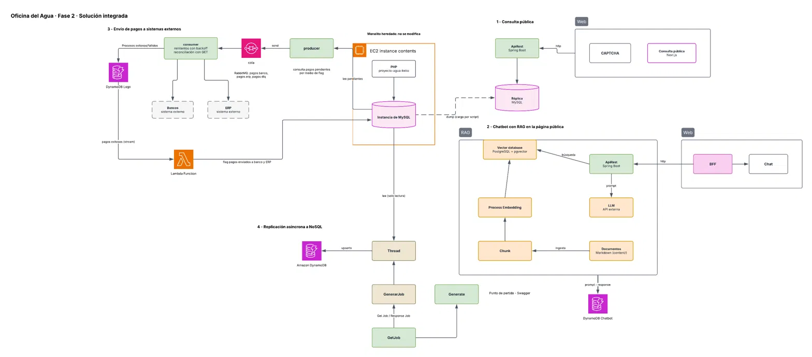
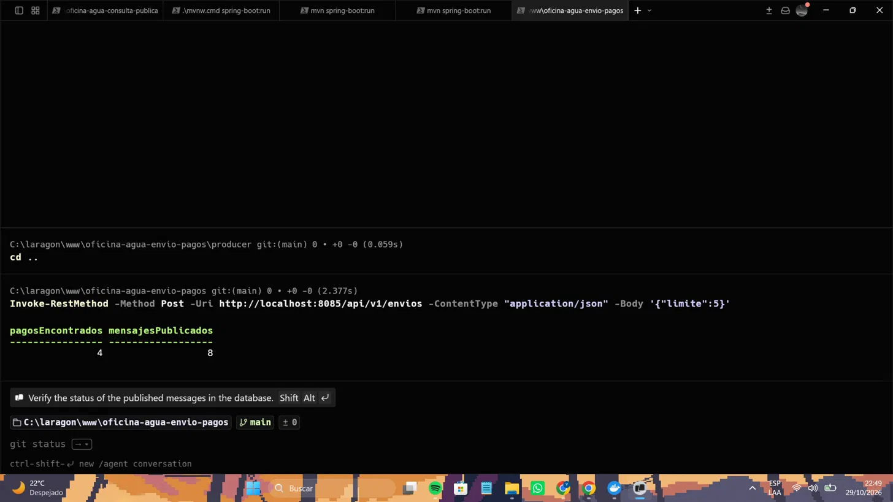
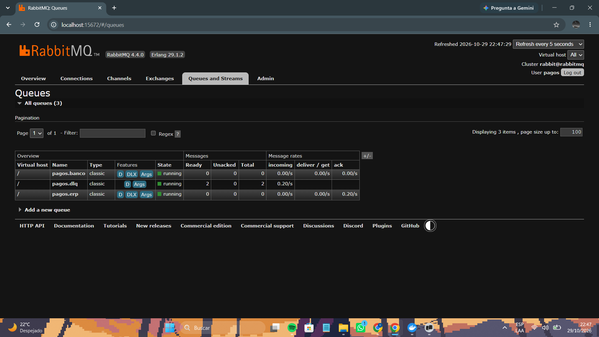
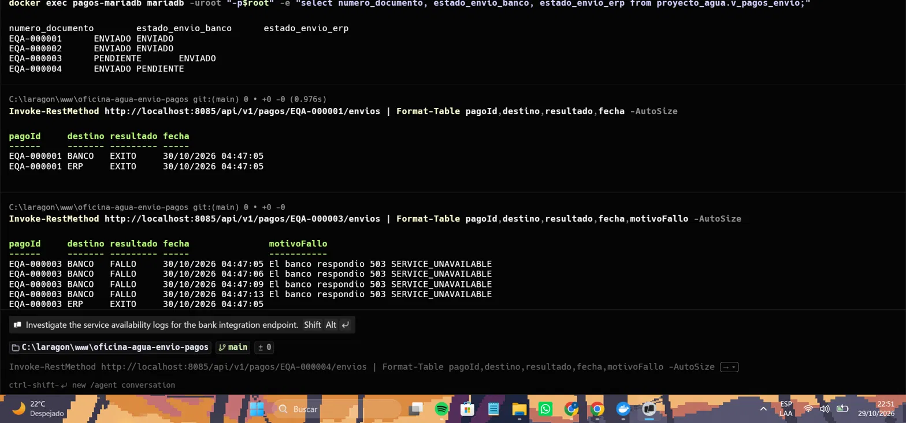
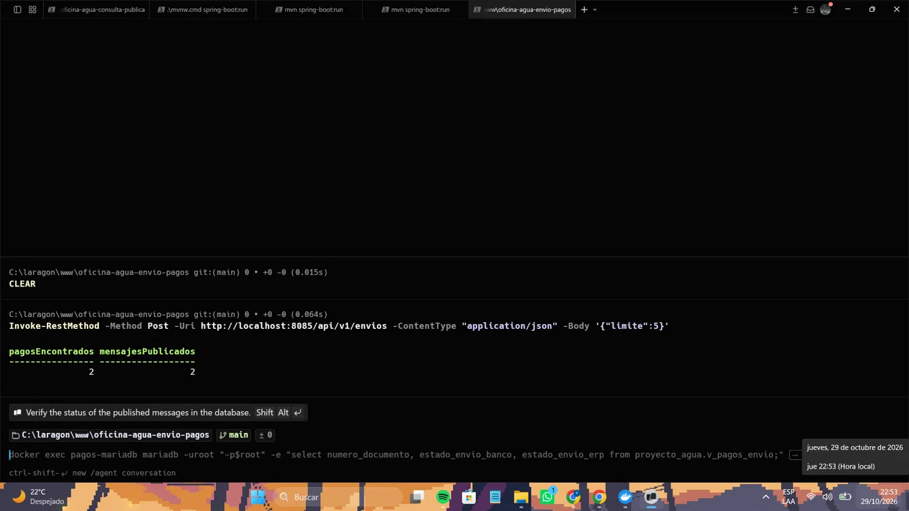

Nombre: Enner Osvaldo Godoy Ramírez  
Carnet: 0905-23-15908  
Repositorio: https://github.com/oficina-agua-keko/oficina-agua-envio-pagos  
Modulo asignado: Envío de pagos a sistemas externos por colas

# Oficina del Agua — Fase 2 · Feature 3: Envío de pagos a sistemas externos por colas

Fase 2 · Desarrollo Web 2026 · Universidad Mariano Gálvez

Servicio que entrega cada pago de la Oficina del Agua a un **banco** y a un **ERP**, **una sola
vez** y aunque esos sistemas fallen, **sin modificar el monolito heredado**. Los pagos viajan por
RabbitMQ, cada intento queda registrado en DynamoDB y una Lambda marca los pagos entregados.

**Contenido:** [1. Arquitectura de la solución integrada](#1-arquitectura-de-la-solución-integrada) ·
[2. Cómo se ejecuta la solución integrada](#2-cómo-se-ejecuta-la-solución-integrada) ·
[3. Mi módulo: envío de pagos por colas](#3-mi-módulo-envío-de-pagos-a-sistemas-externos-por-colas) ·
[4. Evidencias](#4-evidencias) ·
[5. Seguridad](#5-seguridad-de-la-información) ·
[6. Equipo y flujo de trabajo](#6-equipo-y-flujo-de-trabajo)

---

## 1. Arquitectura de la solución integrada

La Fase 2 agrega **cuatro features nuevas al lado del monolito heredado**. Cada feature vive en
su propio repositorio y se ejecuta con su propio `docker-compose.yml`; se comunican por HTTP,
por colas de mensajes o por lectura de bases de datos, según el caso.



*Diagrama elaborado por el equipo (Enner Godoy). Si la imagen no carga, está en
[`docs/arquitectura-fase2.png`](docs/arquitectura-fase2.png).*

### Repositorios

| Componente | Repositorio |
|---|---|
| Monolito heredado (CodeIgniter 4, PHP 8.2) | [proyecto-agua-keko](https://github.com/KravenTA/proyecto-agua-keko) |
| Feature 1 · Consulta pública con captcha | [oficina-agua-consulta-publica](https://github.com/oficina-agua-keko/oficina-agua-consulta-publica) |
| Feature 2 · Chatbot con RAG | [proyecto-agua-chatbot-rag](https://github.com/oficina-agua-keko/proyecto-agua-chatbot-rag) |
| Feature 3 · Envío de pagos a sistemas externos | [oficina-agua-envio-pagos](https://github.com/oficina-agua-keko/oficina-agua-envio-pagos) (este repositorio) |
| Feature 4 · Replicación asíncrona a NoSQL | [oficina-agua-sync-nosql](https://github.com/oficina-agua-keko/oficina-agua-sync-nosql) |

### Monolito heredado

Sistema existente en **CodeIgniter 4 (PHP)** con su base MySQL de la Oficina del Agua
(clientes, contadores, lecturas, recibos, pagos). **No se modifica su código ni sus tablas
existentes.** Las features lo consultan de forma indirecta:

- Feature 1 usa una **réplica** cargada con un dump, nunca la base original.
- Feature 4 lee la base de origen con un usuario de **solo lectura**.
- Feature 3 lee los pagos pendientes con un usuario de solo lectura sobre una **vista**
  (`v_pagos_envio`). Los únicos objetos nuevos que sus scripts de `db/` agregan en esa base
  son la tabla `pagos_envio` (marcas de entrega) y esa vista, con usuarios de permisos mínimos
  (`pagos_ro`: `SELECT` sobre la vista; `lambda_flags`: `INSERT` sobre `pagos_envio`).

### Componentes por feature

| Feature | Componentes | Tecnología |
|---|---|---|
| **1 · Consulta pública** | Página pública con captcha · ApiRest de consulta · Réplica MySQL | Next.js · Spring Boot · MySQL |
| **2 · Chatbot con RAG** | Widget de chat y BFF · ApiRest del chatbot · Vector database · Proceso de ingesta (chunk + embeddings) · LLM · DynamoDB del chatbot | Paquete `oficina-agua-chat-widget` · Spring Boot · PostgreSQL + pgvector · API externa de LLM y embeddings · DynamoDB |
| **3 · Envío de pagos** | Producer · cola · Consumer · Bancos y ERP (sistemas externos) · DynamoDB de logs · Lambda | Spring Boot · RabbitMQ · DynamoDB · Python |
| **4 · Replicación a NoSQL** | sync-service (generar job, consultar job, replicar) · base de origen · DynamoDB | Spring Boot · MySQL · DynamoDB |

### Qué representa cada conexión

| Flujo | Recorrido |
|---|---|
| **1 · Consulta pública** | Navegador → página Next.js (valida el captcha **en servidor**) → `http` → ApiRest (rate limit por IP) → **Réplica MySQL** (solo lectura). La réplica se carga con un dump de la base del monolito mediante `scripts/refrescar-replica.ps1`. |
| **2 · Chat con RAG** | Documentos Markdown (`content/`) → *chunk* → *embeddings* → vector database (ingesta, una vez). En cada pregunta: navegador → widget en la página de la Feature 1 → BFF `/api/chat` → `http` → ApiRest del chatbot → búsqueda en pgvector → *prompt* al LLM externo → respuesta con fuentes. Cada *prompt/response* se guarda en DynamoDB del chatbot. |
| **3 · Envío de pagos** | Producer lee los pagos pendientes por medio de un flag (vista sobre la base de pagos) → publica en RabbitMQ (`pagos.banco`, `pagos.erp`) → Consumer entrega a Bancos y ERP con reintentos con *backoff* y reconciliación con GET → los resultados exitosos y fallidos van a DynamoDB de logs → su *stream* dispara la Lambda → la Lambda marca el envío en `pagos_envio` para que no se reenvíe. Los mensajes que agotan sus reintentos van a `pagos.dlq`. |
| **4 · Replicación a NoSQL** | `POST /api/sync/resumen` crea un *job* y responde `202` con su `jobId` → el servicio lee la base de origen (solo lectura) en segundo plano y hace *upserts* en DynamoDB → `GET /api/sync/jobs/{jobId}` consulta el estado (`PENDIENTE`, `COMPLETADO`…). |

### Cómo leer el diagrama frente a la implementación

- El **chat de la Feature 2 no es una página aparte**: el widget y su BFF se montan dentro de la
  aplicación Next.js de la Feature 1 (HU-59). El diagrama los dibuja como bloque separado
  porque son dos features distintas.
- En local, DynamoDB corre como **DynamoDB Local**, los sistemas externos (Bancos y ERP) se
  simulan con **WireMock** y el broker es **RabbitMQ**.
- Los nombres *Thread / GenerarJob / Generate / GetJob* del bloque 4 son conceptuales; en el
  servicio son los endpoints `POST /api/sync/resumen` y `GET /api/sync/jobs/{jobId}`.
- Los *embeddings* y el LLM del chatbot se consumen de una API externa; su clave nunca se
  versiona ni llega al navegador.

---

## 2. Cómo se ejecuta la solución integrada

No existe un `docker-compose.yml` único: **cada feature tiene el suyo**, y se levantan una a
una. Todos los puertos son configurables por variables de entorno, así que las cuatro pueden
convivir en la misma máquina.

**Requisitos:** Docker Desktop, Git, Java 21 o superior y Maven 3.9+ (producer y consumer de la
Feature 3; el ApiRest del chatbot trae su propio `mvnw`) y Node 22+ solo para correr las
pruebas de la capa web.

### Puertos usados en la prueba integrada

| Feature | Servicio | Puerto |
|---|---|---|
| 1 | web · api · réplica MySQL | 3000 · 8081 · 3307 |
| 2 | ApiRest del chatbot (`SERVER_PORT`) · pgvector · DynamoDB · Swagger UI | 8084 · 5433\* · 8000 · 8082 |
| 3 | RabbitMQ (AMQP / consola) · DynamoDB · banco falso · ERP falso · producer · consumer · base de pagos | 5672 / 15672 · 8001 · 8089 · 8090 · 8085 · 8086 · 3309 |
| 4 | sync-service · base de origen · DynamoDB | 8083 · 3308 · 8002 |

\* El puerto por defecto de pgvector es `5432`. Si en tu máquina hay un PostgreSQL instalado,
cámbialo con `POSTGRES_PORT` y apunta la API con `VECTOR_DB_URL`.

### Orden de arranque

**Feature 4** (solo Docker):
```bash
git clone https://github.com/oficina-agua-keko/oficina-agua-sync-nosql.git
cd oficina-agua-sync-nosql
cp .env.example .env     # SYNC_API_KEY=<una clave local>, DYNAMODB_HOST_PORT=8002
docker compose up -d --build
```

**Feature 1** (consulta pública):
```bash
git clone https://github.com/oficina-agua-keko/oficina-agua-consulta-publica.git
cd oficina-agua-consulta-publica
cp .env.example .env     # ajustar valores; nunca subir el .env
docker compose up -d --build
powershell -ExecutionPolicy Bypass -File scripts\refrescar-replica.ps1   # carga la réplica
```

**Feature 2** (chatbot):
```bash
git clone https://github.com/oficina-agua-keko/proyecto-agua-chatbot-rag.git
cd proyecto-agua-chatbot-rag
cp .env.example .env
docker compose up -d                       # pgvector, DynamoDB, Swagger UI
cp api/secrets.properties.example api/secrets.properties
# editar api/secrets.properties y poner chatbot.llm.api-key=<tu clave> (archivo no versionado)
cd api
./mvnw spring-boot:run -Dspring-boot.run.arguments=--ingesta   # solo la primera vez
SERVER_PORT=8084 ./mvnw spring-boot:run                        # deja esta terminal abierta
```
En Windows (PowerShell): `$env:SERVER_PORT=8084` y `.\mvnw.cmd`. El ApiRest de la Feature 1
ya usa el 8081, por eso el chatbot corre en el 8084 y `CHAT_API_URL` apunta a él.

**Feature 3** (envío de pagos, este repositorio): necesita una base MySQL/MariaDB con las tablas del monolito y
los scripts de `db/` aplicados (`00-pagos_envio.sql`, `01-v_pagos_envio.sql`,
`02-usuarios.sql`). Para probar sin tocar la base real puede usarse un MariaDB desechable
cargado con los scripts de `db/origen/` de la Feature 4. Después:
```bash
git clone https://github.com/oficina-agua-keko/oficina-agua-envio-pagos.git
cd oficina-agua-envio-pagos
cp .env.example .env      # puertos, usuarios de base y RabbitMQ (ver README del repositorio)
docker compose up -d --build        # RabbitMQ, DynamoDB, simuladores y Lambda
cd consumer && SERVER_PORT=8086 mvn spring-boot:run    # terminal 1
cd producer && SERVER_PORT=8085 mvn spring-boot:run    # terminal 2
```

Cada repositorio detalla sus variables en su `.env.example` y su README.

---

## 3. Mi módulo: envío de pagos a sistemas externos por colas

### 3.1 Funcionalidad y objetivo

**Problema del negocio.** La Oficina del Agua registra los pagos en el monolito, pero el banco
y el ERP municipal también necesitan conocerlos. Enviarlos directamente desde el monolito lo
haría depender de dos sistemas externos que pueden caerse, tardar o recibir el mismo pago dos
veces, y además obligaría a modificarlo, cosa que la fase prohíbe.

**Qué se construyó.** Un servicio separado que:

1. **Detecta los pagos pendientes** de enviar a cada destino, sin tocar el monolito.
2. **Los encola en RabbitMQ**, un mensaje por pago y por destino, para que nada se pierda
   aunque un destino esté caído.
3. **Los entrega** al banco y al ERP **una sola vez**, con reintentos ante fallos temporales.
4. **Registra cada intento** en DynamoDB, también los fallidos, como historial auditable.
5. **Marca en MySQL** los pagos entregados para no volver a enviarlos.
6. **Aparta en una cola de errores (DLQ)** lo que no se pudo entregar, para reprocesarlo cuando
   el destino se recupere.

**Recorrido de un pago:**

```text
 MySQL                                                               API Banco
 v_pagos_envio ──► PRODUCER ──► RabbitMQ ──► CONSUMER ──(Feign)──►   API ERP
 (pendientes)                   pagos.banco   BancoListener
                     ▲          pagos.erp     ErpListener
                     │          pagos.dlq ◄── (reintentos agotados)
                     │                            │
                     │                            ▼ cada intento
                     │                      DynamoDB Logs ── stream ──► LAMBDA
                     │                                                    │
                     └──── ya no lo publica ◄── pagos_envio (ENVIADO) ◄───┘
```

1. El **producer** (`POST /api/v1/envios`) lee la vista `v_pagos_envio` y publica en
   `pagos.exchange` un mensaje por cada pago y destino pendiente. Cada mensaje lleva una
   **llave estable** (`EQA-000123`, derivada del id del pago) y un `correlationId`.
2. RabbitMQ lo enruta a `pagos.banco` o `pagos.erp` según la *routing key*.
3. El **consumer** (`BancoListener` o `ErpListener`) revisa en DynamoDB si ese pago ya se
   entregó. Si no, lo traduce al contrato del destino y lo envía con **FeignClient**.
4. Ante fallos temporales **reintenta con backoff exponencial**. Si agota los intentos, el
   mensaje va a `pagos.dlq` con el motivo en sus headers.
5. Cada intento queda como una línea en **DynamoDB** (`pagos-envio-logs`).
6. La **Lambda** escucha el *stream* de DynamoDB y, por cada intento `EXITOSO`, inserta la marca
   en `pagos_envio`. La vista muestra ese destino como `ENVIADO` y el producer ya no lo publica.

### 3.2 Integración y responsabilidades

| Componente | Se comunica con | Por qué esa frontera |
|---|---|---|
| Producer | Base del monolito (lectura de la vista `v_pagos_envio`) · RabbitMQ | Usa `pagos_ro`, que **solo tiene `SELECT` sobre la vista**: no ve las tablas originales ni puede modificarlas. No llama al banco ni al ERP. |
| RabbitMQ | Producer · Consumer | Desacopla al que detecta los pagos del que los entrega. Si un destino cae, los mensajes esperan en la cola sin perderse. |
| Consumer | Banco y ERP por `http` (FeignClient) · DynamoDB | Es la **única pieza que conoce los contratos externos** (DTOs escritos a mano según `docs/openapi/`). Las URLs y API keys llegan por variables de entorno. No tiene permisos sobre la base del monolito. |
| DynamoDB Logs | Consumer (escribe) · Producer (lee el historial) · Lambda (por el *stream*) | El historial de intentos crece con cada envío y no pertenece al monolito. |
| Lambda | DynamoDB (*stream*) · base del monolito (escritura) | Es la **única pieza que escribe** en la base, con `lambda_flags`, que **solo puede hacer `INSERT` en `pagos_envio`**. |

Reglas que se cumplen: el monolito heredado no se modifica (solo se agregaron la vista
`v_pagos_envio` y la tabla `pagos_envio`); ninguna credencial está en el código; los contratos
OpenAPI del docente se guardan sin modificar; las operaciones con colas se procesan con los
componentes realmente implementados (RabbitMQ, producer, consumer y Lambda).

### 3.3 Decisiones técnicas

**a) Marcar los envíos en una tabla aparte, escrita por una Lambda, en lugar de agregar una
columna al monolito.** El diagrama pide consultar los pagos pendientes "por medio de un flag".
La opción obvia era una columna `enviado` en `pagos`, pero eso **modificaba el monolito** y solo
serviría para un destino. Se eligió una tabla nueva, `pagos_envio (pago_id, destino)`, donde
*la fila existe = ENVIADO*:

- el monolito queda intacto;
- el flag es **por destino**: un pago puede estar enviado al banco y pendiente para el ERP;
- la llave primaria `(pago_id, destino)` impide marcar dos veces (la Lambda recibe el error
  1062 y lo trata como `YA_MARCADO`);
- como las marcas se derivan del registro de DynamoDB, **se pueden reconstruir** si se pierden.

Que el consumer escribiera la marca directamente se descartó porque le daría permisos de
escritura sobre la base del monolito; con la Lambda, cada pieza tiene el mínimo permiso posible.

**b) Idempotencia con llave estable y reconciliación, en lugar de suponer que cada llamada se
hace una sola vez.** En una cola, un mensaje puede llegar dos veces, y un *timeout* no dice si el
banco registró el pago. Reintentar a ciegas podría registrar el pago **dos veces**. Por eso:

- cada pago usa siempre la misma llave (`Idempotency-Key` en el banco, `documento_origen.numero`
  en el ERP), y un `409` de duplicado se trata como entregado;
- antes de enviar, el consumer revisa en DynamoDB si ya hay un intento exitoso;
- ante un *timeout* o un `504`, primero **pregunta con `GET`** si el destino ya tiene el pago y
  solo reintenta si responde `404`.

**c) RabbitMQ con DLQ y reintentos con backoff, en lugar de una llamada HTTP directa.** Una
llamada directa falla en cuanto el destino cae. Con la cola, el pago espera. El consumer
reintenta con espera exponencial (1 s, 2 s, 4 s; máximo 4 intentos), respetando `Retry-After`; si
aun así no lo logra, el mensaje no se pierde ni se reintenta para siempre: queda en `pagos.dlq`
con headers que explican el motivo, y se reprocesa con un endpoint cuando el destino vuelve. El
producer publica con **publisher confirms**: si RabbitMQ no confirma, responde error en lugar de
dar el envío por hecho.

### 3.4 Instrucciones para probar el módulo

**Requisitos previos:** Docker, Java 21+, Maven 3.9+ y una base MySQL/MariaDB con las tablas del
monolito y los scripts de `db/` aplicados (ver sección 2). Por defecto el módulo usa un **banco y
un ERP falsos** (WireMock, incluidos en el `docker-compose.yml`), así que **no hace falta la clave
del simulador del docente**.

Los puertos de esta sección son los que usa el módulo cuando corre **solo** (producer 8081,
consumer 8082). En la prueba integrada de la sección 2 corrieron en 8085 y 8086.

**Arranque:**
```bash
cp .env.example .env               # completar contraseñas; nunca subir el .env
docker compose up -d               # RabbitMQ, DynamoDB Local, Lambda, banco y ERP falsos
cd consumer && mvn spring-boot:run # terminal 1
cd producer && mvn spring-boot:run # terminal 2
```

**Prueba 1 · camino feliz**

1. Abrir Swagger del producer: **http://localhost:8081/swagger-ui/index.html**
2. Ejecutar `POST /api/v1/envios` con `{ "limite": 1 }`.
3. **Resultado esperado:**
    - la respuesta indica **1 pago encontrado y 2 mensajes publicados** (banco y ERP);
    - el consumer registra `Pago EQA-000001 entregado al banco` y `contabilizado en el ERP`;
    - `docker compose logs lambda-marcar-flags` muestra `Pago 1 en BANCO: MARCADO` y `Pago 1 en ERP: MARCADO`;
    - en la base, `v_pagos_envio` muestra el pago 1 como **ENVIADO / ENVIADO**.
4. `GET /api/v1/pagos/EQA-000001/envios` devuelve el historial de intentos por destino. Con un
   documento inexistente (`EQA-999999`) responde **404**.

**Prueba 2 · fallo, reintentos y DLQ.** El banco falso responde `503` con el pago `EQA-000003`.

1. Repetir `POST /api/v1/envios` hasta que se publique el pago 3.
2. **Resultado esperado:**
    - el consumer registra `Intento 1 de 4 fallido, se reintenta en 1000 ms`, luego 2000 y 4000 ms,
      y al final `NO entregado al banco tras 4 intento(s)`;
    - en el panel de RabbitMQ (**http://localhost:15672**) la cola `pagos.dlq` tiene **1 mensaje**;
    - la Lambda **no marca** el pago y sigue **PENDIENTE** para el banco.
3. Simular que el banco se recupera y reprocesar la DLQ:
   ```bash
   curl -X POST http://localhost:8089/simular/recuperar
   curl -X POST "http://localhost:8082/api/v1/dlq/reprocesar?limite=20"
   ```
4. **Resultado esperado:** el pago se entrega, `pagos.dlq` queda vacía, la Lambda registra
   `Pago 3 en BANCO: MARCADO` y la vista lo muestra como **ENVIADO**.

**Datos de prueba programados en el banco y el ERP falsos:**

| Documento | Comportamiento |
|---|---|
| EQA-000003 | Banco caído (`503`) |
| EQA-000004 | ERP caído |
| EQA-000005 | Límite de peticiones (`429` con `Retry-After`) |
| EQA-000006 | *Timeout*: el consumer reconcilia con `GET` |
| EQA-000007 | Falla una vez y luego acepta |

Para repetir la prueba 2: `curl -X POST http://localhost:8089/__admin/scenarios/reset`.

**Pruebas automatizadas:**
```bash
cd consumer && mvn test     # 103 pruebas (necesita DynamoDB Local encendido)
cd producer && mvn test     # 14 pruebas (necesita la base de pagos)
docker run --rm -v "${PWD}/lambda/marcar_flags:/app" -w /app python:3.12-slim \
  sh -c "pip install -q -r requirements-dev.txt && python -m pytest -q"   # 7 pruebas de la Lambda
```

**Contra los simuladores del docente:** se cambian en el `.env` `BANCO_URL`, `ERP_URL` y sus API
keys, y se reinicia el consumer. `SIMULACION_ESCENARIO` fuerza un escenario (`SUCCESS`,
`ERROR_500`, `ERROR_503`, `SLOW`); vacío equivale a AUTO.

**Dónde está implementado cada mecanismo:**

| Mecanismo | Archivo |
|---|---|
| Consulta de pendientes y publicación con confirmación | `producer/.../envio/EnvioService.java`, `producer/.../pago/PagoRepository.java` |
| Historial de un pago | `producer/.../historial/HistorialController.java` |
| Listeners, idempotencia y re-marca | `consumer/.../banco/BancoListener.java`, `consumer/.../erp/ErpListener.java` |
| Llamadas HTTP (Feign), clasificación de respuestas y reconciliación con `GET` | `consumer/.../banco/EnvioBancoService.java`, `consumer/.../erp/EnvioErpService.java` |
| Política de reintentos (backoff y `Retry-After`) | `consumer/.../reintentos/PoliticaReintentos.java`, `Reintentador.java` |
| DLQ con motivo y reproceso | `consumer/.../reintentos/DeadLetterPublicador.java`, `ReprocesadorDlq.java`, `DlqController.java` |
| Registro en DynamoDB | `consumer/.../logs/LogEnvioRepository.java` |
| Marcado de enviados | `lambda/marcar_flags/handler.py` (`poller_local.py` imita el disparador de AWS en local) |
| Topología de RabbitMQ | `rabbitmq/definitions.json` |
| Vista, tabla y usuarios | `db/` |

---

## 4. Evidencias

Capturas de la prueba integrada, con las cuatro features corriendo juntas en una misma máquina.
Las de las otras features están en el README de
[`oficina-agua-consulta-publica`](https://github.com/oficina-agua-keko/oficina-agua-consulta-publica#4-evidencias-de-la-solución-integrada).

**Envío:** se encontraron 4 pagos y se publicaron 8 mensajes (uno por pago y por destino).


**Colas en RabbitMQ:** `pagos.banco` y `pagos.erp` quedan vacías y `pagos.dlq` conserva los dos
envíos que los simuladores rechazan a propósito.


**Estado e historial:** los entregados quedan `ENVIADO`; los que fallan muestran los reintentos
con espera creciente entre intentos.


**Sin duplicados:** repetir el envío solo republica los dos destinos que siguen pendientes.


**Pruebas contra los simuladores del docente** (escenarios `ERROR_503`, `ERROR_500`, `SUCCESS`,
AUTO y llamada sin API key): [`docs/evidencias/hu-61`](docs/evidencias/hu-61/README.md).

---

## 5. Seguridad de la información

- Ninguna contraseña, token ni clave de API se versiona: viven en el `.env`, que está en
  `.gitignore`. El repositorio solo incluye `.env.example` con valores de ejemplo.
- Se revisó el historial completo de Git: ningún commit contiene el `.env`, las claves del
  simulador ni contraseñas.
- La base del monolito se usa con **permisos mínimos**: `pagos_ro` solo lee la vista y
  `lambda_flags` solo inserta en `pagos_envio`.
- La API key del banco y del ERP se envía en la cabecera `x-api-key` y llega solo por variable
  de entorno. Las evidencias muestran que una llamada sin esa cabecera recibe `403`.

---

## 6. Equipo y flujo de trabajo

| Nombre completo | Carnet | Correo electrónico | Rol dentro del equipo |
|---|---|---|---|
| Yourgen Kraven Thommel Arevalo | 0905-23-14003 | ythommela@miumg.edu.gt | Coordinador |
| Karen Yamileth Jiménez Galicia | 0905-23-7626 | kjimenezg6@miumg.edu.gt | Desarrolladora |
| Enner Osvaldo Godoy Ramírez | 0905-23-15908 | egodoyr2@miumg.edu.gt | Desarrollador · responsable de la Feature 3 |
| Oliver Isaac Godoy Salguero | 0905-23-10816 | ogodoys@miumg.edu.gt | Desarrollador |

**Proyecto en Jira:** SDGODA · Feature 3 (historias HU-40 a HU-49, HU-60 y HU-61).

### Estructura del repositorio

```
.
├── producer/              Spring Boot: publica los pagos pendientes y expone la API
├── consumer/              Spring Boot: listeners de banco y ERP, reintentos, DLQ y registro
├── lambda/marcar_flags/   Lambda en Python que marca los pagos enviados
├── wiremock/              Banco y ERP falsos para pruebas locales
├── rabbitmq/              Topología de RabbitMQ (definitions.json)
├── db/                    Tabla de marcas, vista y usuarios con permisos mínimos
├── docs/                  Diagrama, contratos OpenAPI, capturas y evidencias
├── docker-compose.yml     Infraestructura local de la feature
├── .env.example           Variables de entorno (copiar a .env)
└── README.md
```

### Flujo de trabajo

Se trabaja con ramas y pull requests. **Nunca directo sobre `main`**, que está protegida.

```bash
git checkout main
git pull
git checkout -b feature/SDGODA-XX-descripcion-corta
```

Prefijos de commit: `feat:` funcionalidad nueva · `fix:` correcciones · `test:` pruebas ·
`chore:` configuración y mantenimiento · `docs:` documentación.

### Reglas de esta fase

- El monolito heredado no se toca: ni su código ni sus tablas.
- Los contratos OpenAPI del docente se guardan sin modificar y no se generan clientes desde el
  YAML: se usan DTOs escritos a mano y FeignClient.
- URLs y API keys solo en variables de entorno, documentadas en `.env.example`.
- Se trabaja con datos de prueba y nunca se envían todos los pagos de golpe.

### Documentación elaborada con ayuda de IA

La sección de arquitectura de la solución integrada se redactó en equipo con ayuda de un
asistente de IA (Claude), a partir de los README, los `docker-compose.yml`, los scripts de base
de datos y el código de los cuatro repositorios, y se contrastó con la ejecución real de cada
feature. La sección de este módulo se verificó contra el código de este repositorio: rutas,
puertos, políticas de reintento y comportamientos descritos son los implementados.